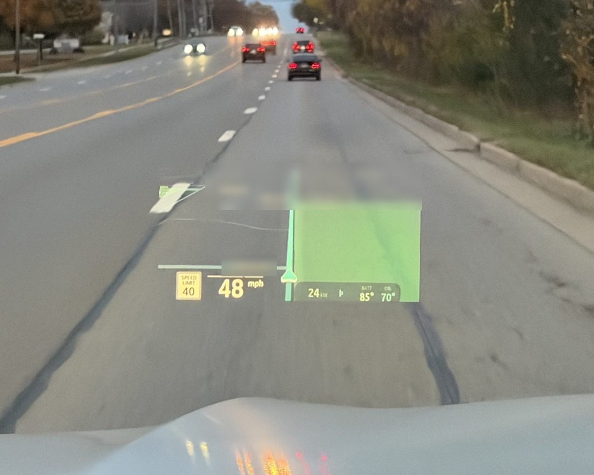
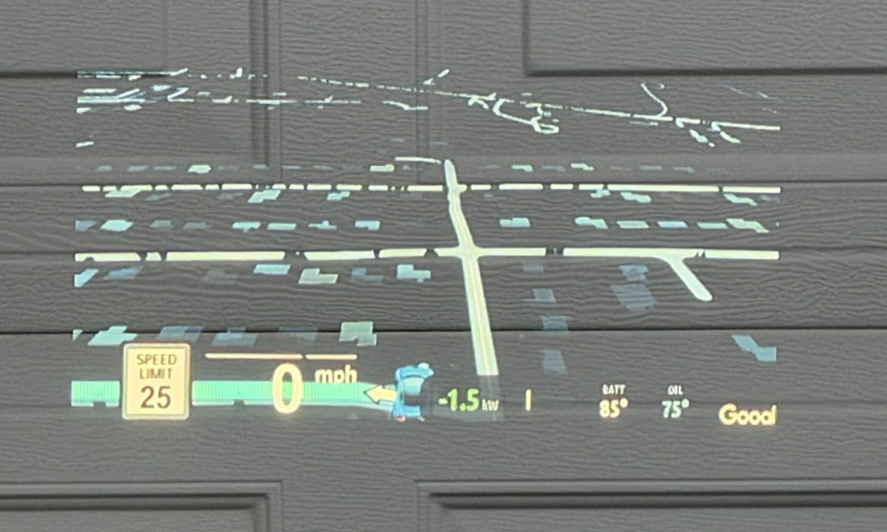
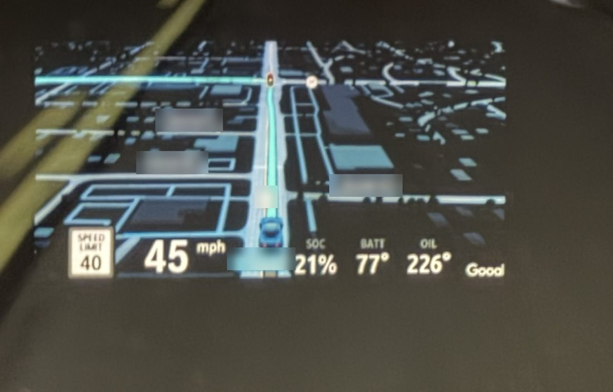

# idrive-apps

> [!WARNING]
> **Disclaimer.** This fork is an independent personal project by eroobeeroo, separate from the original project
> and its authors. It is not affiliated with, endorsed by or supported by any vehicle manufacturer, equipment
> supplier or their partners.
>
> Everything in this repository is provided "as is", without warranty of any kind. Changing a vehicle's software,
> electronics or displays can cause malfunctions, distract the driver, void warranties, break local regulations
> and create safety risks. I am not liable for any damage, injury, loss or other consequence arising from the use
> or misuse of anything in this repository. **I do not recommend that anyone try this on their own vehicle**; if
> you do, you do so entirely at your own risk.

## This fork

[eroobeeroo/idrive-apps](https://github.com/eroobeeroo/idrive-apps) is
[robertnisipeanu/idrive-apps](https://github.com/robertnisipeanu/idrive-apps) as it is (the cluster renderer
included, unchanged), with two additions to Waze on cluster and its app:

- **HUD edge fade** (a button on the app's page: Off, Soft, Medium, Strong): the HUD map's edges feathered to
  black, which the HUD shows as nothing, so the map melts away instead of ending in a hard rectangle.
- **Pause map** (a checkbox): the map hidden on the cluster and the HUD and no frames sent until it is
  unticked, kept across restarts.

- **A layout and the HUD map at once** (cluster-render): the panel target (Cluster Layouts) has its own scene
  id, 0x010004f8, instead of sharing the HUD's 0x01000400, so a layout on the cluster and the Waze map on the
  HUD no longer take turns. The id is on probation: if the cluster restarts twice right after the panel is
  mapped, the renderer goes back to the shared id by itself (native/cluster-render/README.md).

The map settings are saved per driver profile. Its versions sit above the original's (waze-on-cluster 0.9.106
on 0.9.6, the app 0.6.104 on 0.6.4, cluster-render 0.5.100 on 0.5.0), so the Store installs them from here
where both repositories are sources; everything else comes from the original.

Tools and apps for the iDrive 7 head unit (MGU) of a BMW, installed from the
[mgu Store](https://github.com/robertnisipeanu/mgu-store).

| Path | |
|---|---|
| [`native/cluster-render`](native/cluster-render) | the cluster renderer: one service that draws every app's layers on the instrument cluster and the HUD, on iDrive 7 and iDrive 8 |
| [`native/waze-on-cluster`](native/waze-on-cluster) | the CarPlay map (Waze, Apple Maps or Google Maps), or Android Auto's, on the instrument cluster, drawn through cluster-render |
| [`apps/robertn_waze_cluster`](apps/robertn_waze_cluster) | the iDrive app for it: Patch and Remove patch for CarPlay and Android Auto, status, Logs |
| [`release`](release) | builds and publishes the Store catalog |
| `tools` | `oap_pack.js`, `oap_link.js`: pack the app |

## The map on the HUD

The app's **Show on** chooses where the map shows: the instrument cluster (**Cluster**, the default), the head-up
display (**HUD (experimental)**) or both (**Cluster and HUD (experimental)**). With both, the HUD gets up to half the
upload bandwidth, only what it uses, so both stay smooth. HUD support was contributed by
[eroobeeroo](https://github.com/eroobeeroo) and [wesleyredhat](https://github.com/wesleyredhat). Photos from a 2021 X5
xDrive45e (G05); street names blurred.



*The HUD map while driving: the route, the next streets and the speed readout over the road. (The panel at the
bottom right, battery power and temperatures, is a separate app.)*

| Before: Waze's grey-blue night field on the HUD | After: the background made black, which a HUD shows as nothing |
|---|---|
|  |  |

- **Size** - a slider in 5 % steps from 30 % to 85 % of the HUD's width, the picture's shape kept. Standard is the
  fitted box, about 57 %.
- **Position** - **Move left / right / up / down**, 10 px a press, and **Centre**. The map moves at once and is held
  inside the HUD.
- **Made for a HUD** - the frames are scaled on the head unit to the size shown, at most 10 a second, the corners are
  rounded, and a night map's background is made black so only the roads, route and labels float in view (green,
  such as parks, is kept).
- **Gives way** - the map steps aside while the HUD's own media and list pop-ups show, and never replaces BMW's own
  HUD content.
- **Turned off after errors** - if the instrument cluster restarts right after the HUD map shows, twice, the HUD map
  stays off (`HUD map: Disabled after errors`) until the next cluster-render version or `cluster-render guard-reset`;
  the cluster's map keeps working.

On the cluster the map fills the central area:


## Install

In the Store, add the GitHub source `robertnisipeanu/idrive-apps` and install
**Waze on cluster**. The Store installs what it requires first: `mgu-deploy`
0.7.11 from mgu-store, then `cluster-render` and the Waze tool from here. One
head-unit start activates the CarPlay patch, and the Android Auto patch on a
car that supports it. The Store removes them again:
the app, then the tool, then the renderer.

## Build

```sh
make -C native/cluster-render test test-x86 target    # host tests; the unit's toolchain and binary (Docker)
make -C native/waze-on-cluster test test-x86 target
node apps/robertn_waze_cluster/tools/test_control.js
node apps/robertn_waze_cluster/tools/test_page.js
node apps/robertn_waze_cluster/tools/test_i18n.js
node release/test/release_test.js
node release/release.js check                         # reproducible artifacts
```

Each folder's README has the details; [`release/README.md`](release/README.md)
covers versions, the catalog and publishing. Before opening a pull request,
read [`CONTRIBUTING.md`](CONTRIBUTING.md): the release sets versions.

## License

GPL-3.0-or-later ([`LICENSE`](LICENSE)), unless a file's SPDX header says
otherwise. What apps compile in or copy from cluster-render, its `include/`,
`client/`, `kit/`, `js/cluster_render_client.js` and `PROTOCOL.md`, is
MPL-2.0 ([`LICENSES/MPL-2.0.txt`](LICENSES/MPL-2.0.txt)). Third-party files
keep their own licenses: the RAMSES and vsomeip interfaces in cluster-render
(MPL-2.0), the Intel Media SDK headers in waze-on-cluster (MIT), Project
Nayuki's QR code generator in robertn_waze_cluster (MIT).
