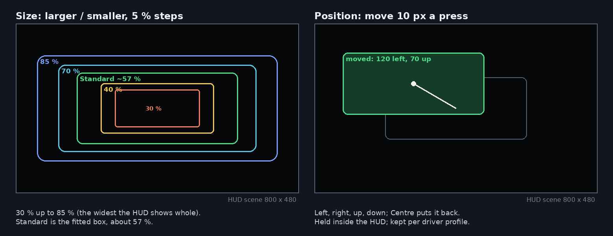
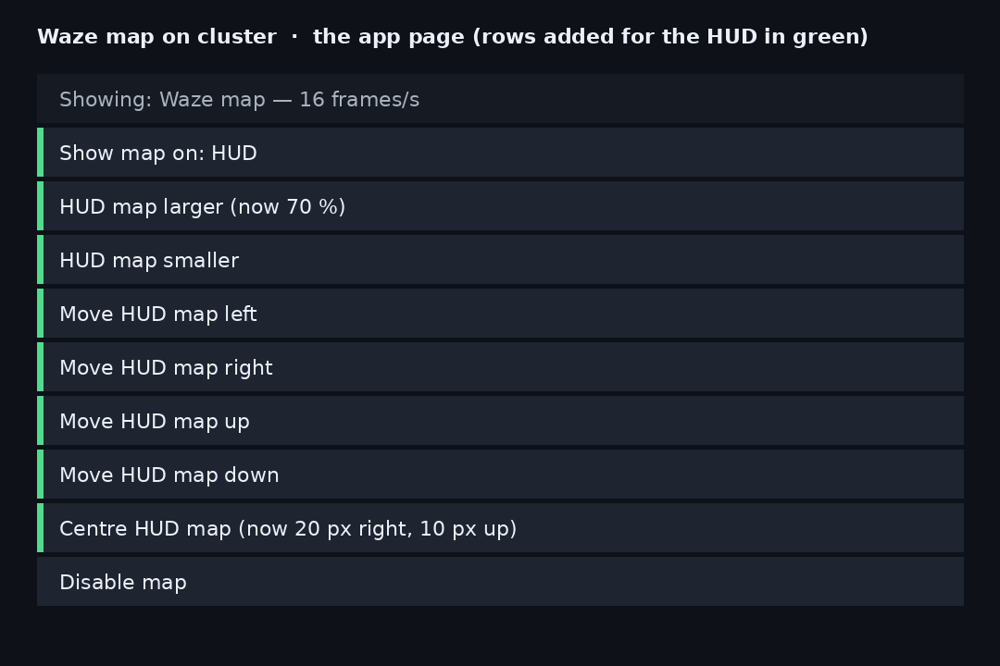
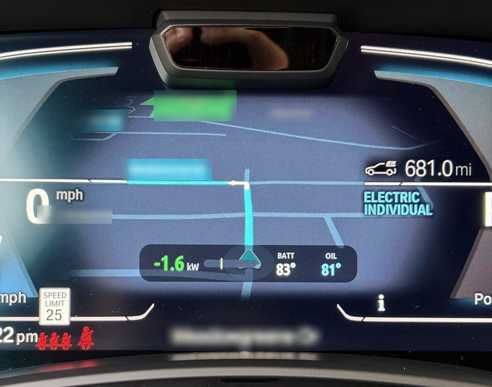

# idrive-apps

> [!WARNING]
> **Disclaimer.** This fork is an independent personal project by eroobeeroo, separate from the original project
> and its authors. It is not affiliated with, endorsed by or supported by any vehicle manufacturer, equipment
> supplier or their partners.
>
> Everything in this repository is provided "as is", without warranty of any kind. Changing a vehicle's software,
> electronics or displays can cause malfunctions, distract the driver, void warranties, break local regulations
> and create safety risks. I am not liable for any damage, injury, loss or other consequence arising from the use
> or misuse of anything in this repository. **I do not recommend that anyone try this on their own vehicle**; if
> you do, you do so entirely at your own risk.

Tools and apps for the iDrive 7 head unit (MGU) of a BMW, installed from the
[mgu Store](https://github.com/robertnisipeanu/mgu-store).

| Path | |
|---|---|
| [`native/cluster-render`](native/cluster-render) | the cluster renderer: one service that draws every app's layers on the instrument cluster and the HUD, on iDrive 7 and iDrive 8 |
| [`native/waze-on-cluster`](native/waze-on-cluster) | the CarPlay map (Waze, Apple Maps or Google Maps), or Android Auto's, on the instrument cluster, drawn through cluster-render |
| [`apps/robertn_waze_cluster`](apps/robertn_waze_cluster) | the iDrive app for it: Patch and Remove patch for CarPlay and Android Auto, status, Logs |
| [`release`](release) | builds and publishes the Store catalog |
| `tools` | `oap_pack.js`, `oap_link.js`: pack the app |

## This fork: the map on the HUD

[eroobeeroo/idrive-apps](https://github.com/eroobeeroo/idrive-apps) adds the head-up display: the CarPlay map
(Waze or Google Maps) shown on the HUD instead of the instrument cluster, switched from the app's page. Photos
from a 2021 X5 xDrive45e (G05); street names blurred.


*The HUD map while driving: the route, the next streets and the speed readout over the road. (The panel at the
bottom right, battery power and temperatures, is the separate [Cluster Info](https://github.com/eroobeeroo/idrive7-apps)
app.)*

| Before: Waze's grey-blue night field on the HUD | After: the background made black, which a HUD shows as nothing |
|---|---|
|  |  |

What it does:

- **Pause map** - a checkbox that hides the map and stops sending it, on the cluster or the HUD, until unticked;
  kept across restarts.
- **Show map on: Cluster / HUD** - one button moves the map between the instrument cluster and the HUD, at once.
- **Size** - **HUD map larger / smaller** in 5 % steps from 30 % to 85 % of the HUD's width (85 %: the widest it
  shows whole), the picture's shape kept. Standard is the fitted box, about 57 %.
- **Position** - **Move HUD map left / right / up / down**, 10 px a press, and **Centre HUD map**. The map moves
  at once (only its place changes, nothing is re-sent) and is held inside the HUD.
- **Made for a HUD** - the frames are scaled on the head unit to the size shown (sharper, 2-6x less data to the
  instrument cluster), the corners are rounded, and a night map's background is made black so only the roads,
  route and labels float in view (green, such as parks, is kept).
- **Edge fade** - **HUD edge fade** steps Off / Soft / Medium / Strong: the map's edges fade to see-through so it
  melts into the HUD instead of ending in a hard rectangle.
- **Gives way** - the map steps aside while the HUD's own media and list pop-ups show, so they stay on the HUD.
- **Per driver** - the display choice, size, position and edge fade are kept for each driver profile and follow the
  driver when the profile changes.





On the cluster, as before, the map fills the central area:



## Install

In the Store, add the GitHub source `robertnisipeanu/idrive-apps` and install
**Waze on cluster**. The Store installs what it requires first: `mgu-deploy`
0.7.11 from mgu-store, then `cluster-render` and the Waze tool from here. One
head-unit start activates the CarPlay patch, and the Android Auto patch on a
car that supports it. The Store removes them again:
the app, then the tool, then the renderer.

## Build

```sh
make -C native/cluster-render test test-x86 target    # host tests; the unit's toolchain and binary (Docker)
make -C native/waze-on-cluster test test-x86 target
node apps/robertn_waze_cluster/tools/test_control.js
node apps/robertn_waze_cluster/tools/test_page.js
node apps/robertn_waze_cluster/tools/test_i18n.js
node release/test/release_test.js
node release/release.js check                         # reproducible artifacts
```

Each folder's README has the details; [`release/README.md`](release/README.md)
covers versions, the catalog and publishing.

## License

GPL-3.0-or-later ([`LICENSE`](LICENSE)), unless a file's SPDX header says
otherwise. What apps compile in or copy from cluster-render, its `include/`,
`client/`, `kit/`, `js/cluster_render_client.js` and `PROTOCOL.md`, is
MPL-2.0 ([`LICENSES/MPL-2.0.txt`](LICENSES/MPL-2.0.txt)). Third-party files
keep their own licenses: the RAMSES and vsomeip interfaces in cluster-render
(MPL-2.0), the Intel Media SDK headers in waze-on-cluster (MIT), Project
Nayuki's QR code generator in robertn_waze_cluster (MIT).
